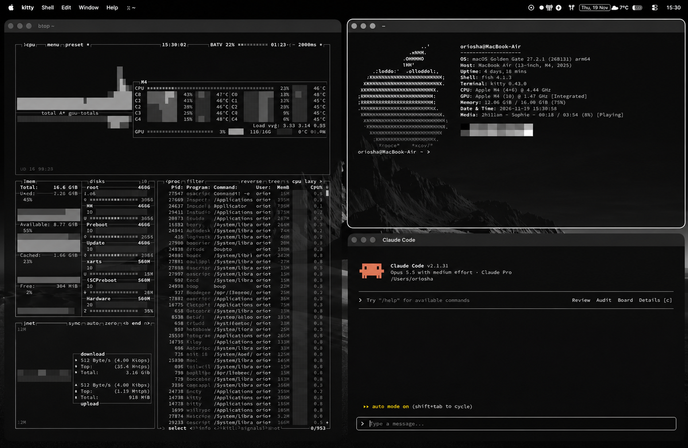
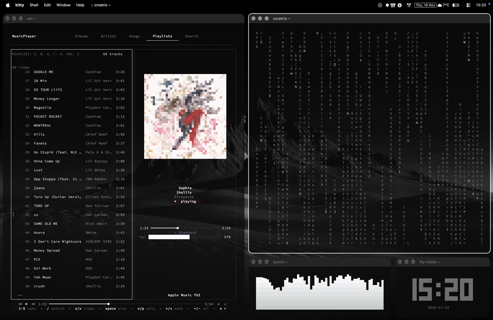
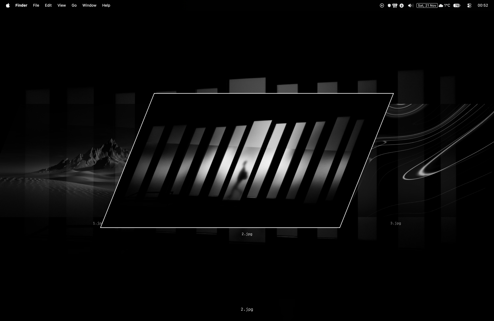

# monochrome-macos-rice

A monochrome macOS terminal setup: black, white and greys only.

## Screenshots







- **kitty**: terminal, Hasklug Nerd Font, translucent background, grey theme
- **fish**: shell with fastfetch on start and short aliases (`ls` = lsd, `cat` = bat, `grep` = rg, ...)
- **cberry** ([cranberry](https://github.com/emreekici3/cranberry)): tiling window manager, with a small patch so binds work while a non-Latin layout (e.g. Russian) is selected
- **sysviz**: audio visualizer for the terminal
- **fastfetch**: grey system info
- **rice-settings**: a small native app to change all of the above (Opt+U or `setup`)
- **wallpicker**: a full-screen wallpaper carousel (Opt+W), see [Wallpaper picker](#wallpaper-picker)
- **AppleMusicTUI** (`musicplayer`): Apple Music in the terminal, recoloured white, with a lyrics view (`l`); start it with `am`

macOS only. sysviz needs macOS 14.2 or newer.

## Shortcuts

| Keys | Action |
| --- | --- |
| Cmd + Enter | open a new kitty window |
| Opt + E | open Finder |
| Opt + U | open Rice Settings |
| Opt + W | wallpaper picker: a full-screen carousel of `~/Pictures/Wallpapers`. Left/Right to move, Return sets the picture on every display and Space, Escape closes |

## Install

```sh
git clone https://github.com/orioshavfx/macos-monochrome-rice.git
cd macos-monochrome-rice && ./install.sh
```

The script is safe to run again. It may ask for your password (Homebrew installer, some casks).

## What gets installed

| What | Where |
| --- | --- |
| Xcode Command Line Tools (if missing; the script stops, run it again afterwards) | system |
| Homebrew (if missing, official installer from brew.sh) | `/opt/homebrew` |
| Brewfile: fish, fastfetch, cmatrix, bat, fd, lsd, btop, tty-clock, neovim, ripgrep, zoxide, mole, go, rust; casks kitty, zotero, font-hasklug-nerd-font | Homebrew |
| fisher (fetched from GitHub) and the plugins in `configs/fish/fish_plugins` | `~/.config/fish` |
| `cberry`, built from cranberry `42b5ed9` + `patches/cranberry-latin-layout.patch` + `patches/cranberry-split-by-size.patch` | `~/bin/cberry` |
| `musicplayer`, built from AppleMusicTUI `eb796cc` + `patches/applemusictui.patch` | `~/bin/musicplayer` |
| `sysviz`, built from sysviz `v0.2.0` | `~/bin/sysviz` |
| Rice Settings app (sources in `rice-settings/`) | `~/Applications/rice-settings.app`, sources in `~/bin/rice-settings` |
| `configs/kitty`, `fish`, `cranberry`, `fastfetch`, `sysviz`, `rice-settings` | `~/.config/<name>/` |
| [wallpicker](https://github.com/orioshavfx/Wallpicker) (Swift app for opt+w, fetched at a pinned commit and built like cberry; skipped with a warning if it does not build) | `~/bin/wallpicker` |
| cberry login service (`cberry install`, `cberry start`) | `~/Library/LaunchAgents` |
| `eval "$(brew shellenv)"`, only if missing, so kitty finds fish | `~/.zprofile` |

Existing files that differ are saved first as `<file>.bak-<timestamp>`. Nothing is deleted.

## Manual steps

1. **Accessibility for cberry.** System Settings > Privacy & Security > Accessibility: add `~/bin/cberry`, then run `~/bin/cberry restart`. After each re-run of the installer the binary is rebuilt: remove it from the list, add it again, restart.
2. **Hide Others shortcut.** macOS uses Cmd+Opt+H for Hide Others, which clashes with the cberry `cmd + alt - h` resize bind. In System Settings > Keyboard > Keyboard Shortcuts > App Shortcuts, add for All Applications the menu title `Hide Others` with Ctrl+Shift+Cmd+H.
3. **Font.** kitty uses Hasklug Nerd Font (installed by the Brewfile). To use another one, change `font_family` in `~/.config/kitty/kitty.conf` or pick it in Rice Settings.
4. Open kitty, then press Opt+U or type `setup`.

On first use macOS also asks to let your terminal capture system audio (sysviz) and control Music (musicplayer). The lyrics view sends the track title and artist to [lrclib.net](https://lrclib.net).

## Wallpaper picker

Opt+W opens **wallpicker**, a separate full-screen carousel. It starts on the wallpaper that is set now, shows the previous and next pictures on either side, and labels each one with its filename. The source lives in its own repository, [orioshavfx/Wallpicker](https://github.com/orioshavfx/Wallpicker), and can be built on its own too.

- Pictures come from `~/Pictures/Wallpapers` by default. The folder and the carousel accent colour are set on the Wallpaper page of Rice Settings (saved to `~/.config/wallpicker/config.toml`).
- Left and Right move through the carousel. Return sets the picture on every display and every Space. Escape closes without changing anything.
- Return writes the picture into macOS's wallpaper store (`~/Library/Application Support/com.apple.wallpaper/Store/Index.plist`) and restarts WallpaperAgent. Before each change the store is copied to `~/.local/state/monochrome-macos-rice/wallpaper-backup`, so the original can be copied back by hand.
- If macOS refuses the write, allow `wallpicker` under Privacy & Security > Full Disk Access.

## Rice Settings

The app opens on Overview: the build (version, commit, build time, macOS) and which parts are installed in `~/bin`. Terminal, WM, Wallpaper, sysviz, fastfetch and App are the other pages; the window is 60% of the screen wide and 70% high.

```sh
setup           # opens ~/Applications/rice-settings.app, builds it first if missing
setup --build   # rebuilds it from ~/bin/rice-settings and opens it
```

Or build it by hand: `sh ~/bin/rice-settings/build.sh`.

## Uninstall

```sh
~/bin/cberry stop; ~/bin/cberry uninstall
rm ~/bin/cberry ~/bin/musicplayer ~/bin/sysviz
rm -rf ~/Applications/rice-settings.app ~/bin/rice-settings ~/.local/state/monochrome-macos-rice
```

To restore a config, find its backups and copy one back:

```sh
ls ~/.config/*/*.bak-* ~/.config/fish/functions/*.bak-* ~/.zprofile.bak-* 2>/dev/null
cp ~/.config/kitty/kitty.conf.bak-20260101-120000 ~/.config/kitty/kitty.conf
```

Homebrew packages stay; remove them with `brew uninstall` if you like.

## Credits

- [cranberry](https://github.com/emreekici3/cranberry) by emreekici3, MIT
- [AppleMusicTUI](https://github.com/sebasreateguib/AppleMusicTUI) by Sebastian Reategui, MIT
- [sysviz](https://github.com/orioshavfx/sysviz) by orioshavfx, MIT
- [fisher](https://github.com/jorgebucaran/fisher) by Jorge Bucaran, MIT

This repo: MIT, see [LICENSE](LICENSE).
